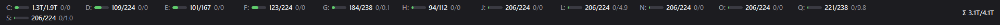

# DiskBar

Cienki pasek dysków dla Windows, w stylu [SysBara](https://github.com/StarGateCommander/SysBar). Pokazuje każdy dysk stały osobno, w zwartej formie, która mieści kilkanaście i więcej dysków. Przydaje się na serwerach i przy maszynach wirtualnych trzymanych na osobnych dyskach.



## Co pokazuje

Każdy dysk to jedna krótka pozycja:

```
C: ▬▬ 120/240  20/30
```

| Element | Znaczenie |
| --- | --- |
| `C:` | litera dysku |
| ▬▬ | pasek zajętości: zielony, od 75% żółty, od 90% czerwony |
| `120/240` | wolne / całkowite w GB. Od 1000 GB z „T”, np. `1.8T/3.6T` |
| `20/30` | odczyt / zapis w MB/s (poniżej 10 MB/s z jednym miejscem po przecinku, od 1000 MB/s w GB/s, np. `3G`) |

- Po najechaniu myszą na dysk pojawia się dymek z pełnymi danymi: etykieta woluminu, procent zajętości, wolne miejsce z jednostkami, odczyt i zapis.
- Po prawej jest podsumowanie: łączne wolne / całkowite miejsce na wszystkich dyskach (`Σ`).
- Liczba pozycji dopasowuje się sama do liczby dysków. Po podłączeniu lub odłączeniu dysku pasek sam się przebudowuje.

## Dużo dysków

Gdy dyski nie mieszczą się w jednym rzędzie, pasek zawija je na kolejne rzędy i sam rezerwuje więcej miejsca na ekranie. Każde pole ma stałą szerokość, liczoną dla najdłuższego możliwego zapisu, więc układ nie zmienia się przy zmianie wartości i dyski nie przeskakują między rzędami.

Każdy kolejny rząd dodaje 20 punktów wysokości.

### Automatyczne skalowanie

Domyślnie włączone (menu pod prawym przyciskiem → „Automatyczne skalowanie”).

- Na ekranie węższym niż 1920 punktów pasek zmniejsza się proporcjonalnie, najwyżej do 75%. Przykład: monitor 1920 px ze skalowaniem Windows 125% ma tylko 1536 punktów, więc pasek dostaje skalę 80%.
- Jeśli zmniejszenie o kolejne kilka procent (w sumie najwyżej o 15%, nie poniżej 75%) oszczędzi jeden rząd, pasek też to zrobi.
- Każdy monitor liczy swoją skalę osobno.

Pokazywane są dyski typu „stały” o pojemności co najmniej 1 GB, w tym dyski USB w obudowach (Windows widzi je jako stałe). Pendrive'y i czytniki kart (dyski wymienne) oraz dyski sieciowe są pomijane.

## Jak działa

- Dokuje się do **górnej** (domyślnie) lub dolnej krawędzi ekranu i rezerwuje tam miejsce, więc zmaksymalizowane okna go nie zasłaniają.
- **Jeśli działa SysBar, DiskBar sam ustawia się pod nim**: każdy pasek dostaje osobny pas ekranu, więc nigdy na siebie nie nachodzą.
- Jeden pasek na każdym monitorze. Po podłączeniu lub odłączeniu monitora paski dodają się i usuwają same.
- Obsługuje monitory o różnym skalowaniu (DPI) i chowa się pod aplikacje pełnoekranowe.
- Menu pod prawym przyciskiem myszy: góra / dół ekranu, **rozmiary w MB** (zamiast GB/TB), „Automatyczne skalowanie”, „Uruchamiaj z Windows”, „Zamknij”.

## Instalacja

Pobierz `DiskBarSetup.exe` z [Releases](https://github.com/StarGateCommander/DiskBar/releases/latest) i uruchom.

- Instaluje dla bieżącego użytkownika do `%LOCALAPPDATA%\Programs\DiskBar`, bez uprawnień administratora.
- Pyta o start razem z Windows, dodaje skrót w menu Start i wpis w „Aplikacje” (odinstalowanie).
- Plik nie jest podpisany cyfrowo, więc SmartScreen może pokazać ostrzeżenie („Więcej informacji” → „Uruchom mimo to”).

Tryb bez okienek (do zdalnego wdrożenia):

```
DiskBarSetup.exe /silent /autostart
DiskBarSetup.exe /uninstall /silent
```

Można też użyć samego `DiskBar.exe`. To pojedynczy plik, nie wymaga instalacji.

## Wymagania

- Windows 10 (1903 lub nowszy) albo Windows 11, 64-bit.
- .NET Framework 4.8, wbudowany w system.

## Kompilacja

```
build.cmd
```

Powstają `DiskBar.exe` (program) i `DiskBarSetup.exe` (instalator z wbudowanym programem). Używa `csc.exe` z .NET Framework, więc nic nie trzeba instalować.

| Plik | Opis |
| --- | --- |
| `DiskBar.cs` | cały program (WPF, jeden plik) |
| `Setup.cs` | instalator / deinstalator |
| `app.manifest` | DPI per monitor, wersja Windows |
| `build.cmd` | kompilacja |
